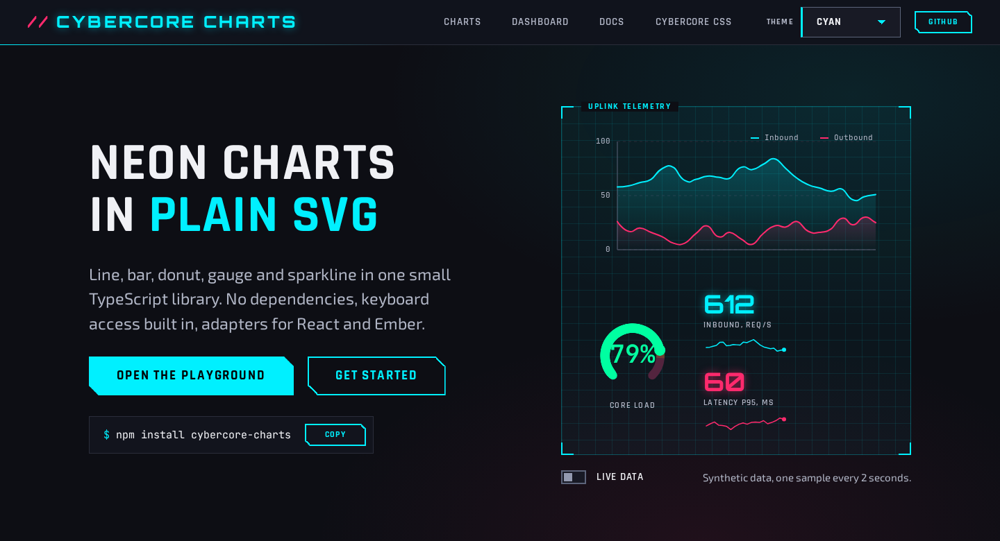
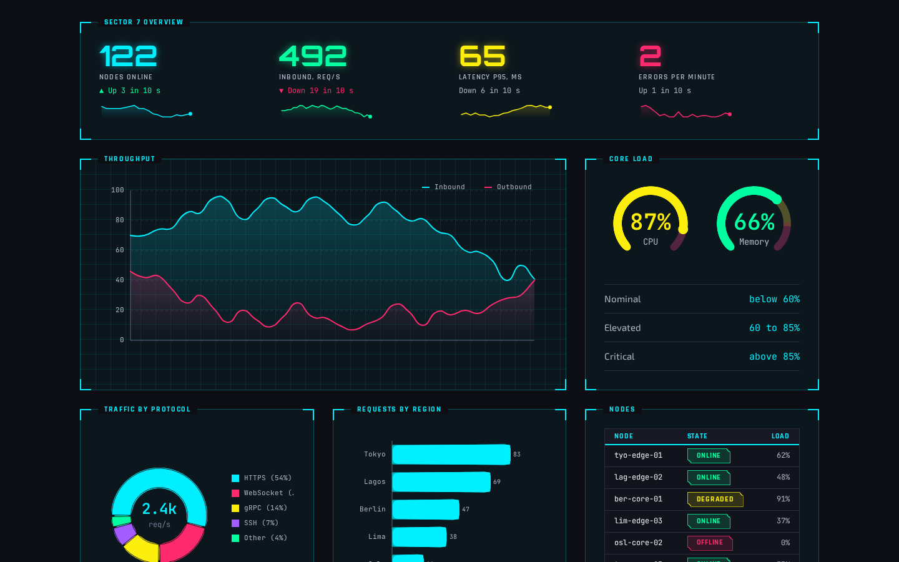

# CYBERCORE CHARTS

[](https://github.com/sebyx07/cybercore-charts/actions/workflows/ci.yml)
[](https://www.npmjs.com/package/cybercore-charts)
[](https://www.npmjs.com/package/cybercore-charts)
[](https://bundlephobia.com/package/cybercore-charts)
[](LICENSE)
[](https://developerz.ai)

Neon charts in plain SVG: line, bar, donut, gauge and sparkline in one small
TypeScript library. No dependencies, keyboard and screen-reader access built in,
adapters for React and Ember.

[](https://sebyx07.github.io/cybercore-charts/)

**[Live demo and playgrounds](https://sebyx07.github.io/cybercore-charts/)** ·
[Line](https://sebyx07.github.io/cybercore-charts/charts/line/) ·
[Bar](https://sebyx07.github.io/cybercore-charts/charts/bar/) ·
[Donut](https://sebyx07.github.io/cybercore-charts/charts/donut/) ·
[Gauge](https://sebyx07.github.io/cybercore-charts/charts/gauge/) ·
[Sparkline](https://sebyx07.github.io/cybercore-charts/charts/sparkline/) ·
[Dashboard example](https://sebyx07.github.io/cybercore-charts/dashboard/) ·
[Docs](https://sebyx07.github.io/cybercore-charts/docs/)

- **Zero dependencies.** `npm install cybercore-charts` installs one package.
  Scales, paths and colour math are in the library.
- **SVG, not canvas.** Sharp at any zoom, printable, styleable with CSS,
  readable by assistive technology. `toSVG()` exports a chart as markup.
- **Accessible by default.** Every chart has a title and a description, a data
  table for screen readers, and keyboard navigation. Reduced motion and high
  contrast are respected.
- **Themeable.** Colours are CSS custom properties with built-in fallbacks. With
  [cybercore-css](https://github.com/sebyx07/cybercore-css) on the page, charts
  follow its theme live.
- **Works where you work.** ES modules, CommonJS, a `<script>` tag, React
  components, an Ember modifier. Safe to import during server rendering.
- **Typed.** Written in TypeScript; every option is documented in the types.
- **AI-ready.** One-file API reference for coding agents:
  [`llms.txt`](llms.txt).

## Quick start

### npm (ES modules)

```bash
npm install cybercore-charts
```

```html
<div id="traffic" style="height: 280px"></div>
```

```ts
import { createChart } from 'cybercore-charts';

const chart = createChart('line', '#traffic', {
  data: [
    { x: 'Mon', y: 12 },
    { x: 'Tue', y: 30 },
    { x: 'Wed', y: 18 },
  ],
  ariaLabel: 'Requests per day',
  showArea: true,
  responsive: true,
});

// later
chart.update([
  { x: 'Mon', y: 14 },
  { x: 'Tue', y: 26 },
  { x: 'Wed', y: 31 },
]);
chart.setOptions({ theme: 'magenta' });
chart.destroy();
```

`createChart(type, container, options)` takes `'line'`, `'bar'`, `'donut'`,
`'gauge'` or `'sparkline'`, and an element or a CSS selector. The classes
(`LineChart`, `BarChart`, `DonutChart`, `GaugeChart`, `Sparkline`) take the same
container and options.

### CDN (no build step)

Pin the version, so a new release never changes your page under you:

```html
<div id="storage"></div>

<script src="https://cdn.jsdelivr.net/npm/cybercore-charts@0.3.0/dist/cybercore-charts.umd.min.js"></script>
<script>
  CyberCharts.createChart('donut', '#storage', {
    data: [
      { label: 'Logs', value: 35 },
      { label: 'Media', value: 25 },
      { label: 'Backups', value: 40 },
    ],
    ariaLabel: 'Storage by kind',
    centerText: '100 GB',
  });
</script>
```

The same file is on unpkg:
`https://unpkg.com/cybercore-charts@0.3.0/dist/cybercore-charts.umd.min.js`. The
[docs page](https://sebyx07.github.io/cybercore-charts/docs/) prints this tag
with a Subresource Integrity hash.

### React

React 18 or later. Every chart option is a prop; the chart is created after
mount, updated in place when props change, and destroyed on unmount.

```tsx
import { CyberBarChart, CyberGaugeChart } from 'cybercore-charts/react';

const latency = [
  { x: 'api', y: 45 },
  { x: 'db', y: 72 },
  { x: 'cache', y: 8 },
];

export function Status() {
  return (
    <>
      <CyberBarChart
        data={latency}
        ariaLabel="Latency by service, in milliseconds"
        orientation="horizontal"
        showValues
        responsive
        style={{ height: 240 }}
        onBarClick={(event) => console.log(event.data)}
      />
      <CyberGaugeChart value={72} label="CPU load" ariaLabel="CPU load" />
    </>
  );
}
```

Components: `CyberLineChart`, `CyberBarChart`, `CyberDonutChart`,
`CyberGaugeChart`, `CyberSparkline`. A ref gives you `update`, `setOptions`,
`resize`, `getSVG`, `toSVG` and `getChart`. The components render an empty
container on the server and draw in the browser.

### Ember

Ember 5 or later with `ember-modifier` 4 or later. One modifier draws every
chart: the first argument names the chart, the named arguments are its options
and event handlers.

```gts
import { cyberChart } from 'cybercore-charts/ember';

<template>
  <div {{cyberChart "line" data=@points showArea=true responsive=true ariaLabel="Requests per day"}}></div>
</template>
```

In classic templates, re-export it once as `app/modifiers/cyber-chart.js` and
use the dashed name:

```js
export { default } from 'cybercore-charts/ember';
```

```hbs
<div {{cyber-chart 'gauge' value=this.load max=100 label='Load'}}></div>
```

## Charts

[](https://sebyx07.github.io/cybercore-charts/dashboard/)

Each chart has a
[playground](https://sebyx07.github.io/cybercore-charts/charts/) where you
change options and data and copy the resulting code for vanilla JS, React or
Ember.

| Chart     | Type          | What it draws                                                            |
| --------- | ------------- | ------------------------------------------------------------------------ |
| Line      | `'line'`      | One or several series; straight, smooth or stepped; optional area fill   |
| Bar       | `'bar'`       | Vertical or horizontal; grouped or stacked series; value labels          |
| Donut     | `'donut'`     | Parts of a whole with a centre readout; a full pie with `innerRadius: 0` |
| Gauge     | `'gauge'`     | One value against a range, with threshold zones and ticks                |
| Sparkline | `'sparkline'` | A word-sized trend line for table cells and stat tiles                   |

Every chart instance has `update(data)`, `setOptions(options)`,
`resize(width, height)`, `getSVG()`, `toSVG()`, `on(event, handler)`,
`off(event, handler)` and `destroy()`.

The options shared by line, bar, donut and gauge:

| Option        | Default        | Meaning                                                          |
| ------------- | -------------- | ---------------------------------------------------------------- |
| `width`       | 400            | Pixels                                                           |
| `height`      | 300            | Pixels                                                           |
| `responsive`  | false          | Follow the size of the container                                 |
| `theme`       | `'accent'`     | `'accent'`, `'cyan'`, `'magenta'`, `'green'` or `'yellow'`       |
| `animate`     | true           | Entry animation; always off when the user prefers reduced motion |
| `glow`        | true           | Neon glow around the marks                                       |
| `scanlines`   | false          | Decorative scanline overlay                                      |
| `tooltip`     | enabled        | `enabled` and a `formatter` that returns text                    |
| `ariaLabel`   | the chart name | Accessible name                                                  |
| `description` | generated      | Accessible description                                           |
| `dataTable`   | true           | Hidden data table for screen readers                             |
| `keyboard`    | true           | Data marks reachable with the keyboard                           |
| `locale`      | runtime locale | BCP 47 locale for numbers and dates                              |

The full list per chart, with types and defaults, is in [`llms.txt`](llms.txt)
and in the types your editor shows.

## Theming with cybercore-css

Every colour a chart uses is a CSS custom property with a built-in fallback.
Load [cybercore-css](https://github.com/sebyx07/cybercore-css) and the charts
take its palette, fonts and accent; leave it out and they render the same neon
look on their own.

```html
<link
  rel="stylesheet"
  href="https://cdn.jsdelivr.net/npm/cybercore-css@0.3.0/dist/cybercore.min.css"
/>

<section data-theme="magenta">
  <div id="traffic"></div>
</section>
```

The default chart theme, `'accent'`, follows `--color-accent`, so a `data-theme`
on the page or on any section retints the charts inside it, live, with no call
into the library. To restyle without the framework, set the same tokens
yourself:

```css
:root {
  --color-accent: #ffb000;
  --cyber-magenta-500: #ff3d8b;
  --color-text-secondary: #d0d4dc;
  --font-mono: 'JetBrains Mono', monospace;
}
```

The tokens a chart reads: `--color-accent` (and its `-light` and `-dark` steps)
for the accent theme; `--cyber-cyan-500`, `--cyber-magenta-500`,
`--cyber-green-500`, `--cyber-yellow-500`, `--cyber-violet-500` and
`--cyber-amber-500` for named themes and series; `--color-text-secondary` and
`--color-text-muted` for labels; `--color-border-strong` and
`--color-border-default` for axes and grid; `--color-bg-elevated`,
`--color-border-accent` and `--color-text-primary` for the tooltip;
`--focus-ring-color`; `--font-mono`.

For one chart, use `theme`, or `color` on a series, a point, a segment or a
threshold. An optional stylesheet adds hover and tooltip polish:
`@use 'cybercore-charts/styles';` in Sass.

## Accessibility

Charts are accessible without configuration:

- **Name and description.** The SVG has a `<title>` from `ariaLabel` and a
  `<desc>` from `description`; when you give no description, a summary of the
  data is generated.
- **Data table.** A visually hidden table of the data follows each chart, so a
  screen reader can read the values (`dataTable`, up to 500 rows).
- **Keyboard.** One tab stop per chart. Arrow keys, Home and End move between
  data marks, Enter or Space activates one, Escape closes the tooltip. Each mark
  has a label.
- **Gauges are meters.** A gauge exposes its value, minimum and maximum to
  assistive technology.
- **Reduced motion.** No animation when the system asks for less motion, or
  inside an element with `data-motion="reduce"`.
- **High contrast.** Text and lines strengthen when the system asks for more
  contrast, or inside `data-contrast="high"`.
- **Not colour alone.** Series are named in the legend, the tooltip and the
  table, and the series palette is ordered to stay distinguishable with the
  common forms of colour blindness.

Give each chart an `ariaLabel` that says what it shows. Found a contrast,
keyboard or screen-reader problem? That is a bug: please
[open an issue](https://github.com/sebyx07/cybercore-charts/issues/new/choose).

## Server rendering

Importing the package in Node is safe: nothing touches the DOM at import time. A
chart needs a DOM to draw, so create it in the browser, in your framework's
mount hook; the React components and the Ember modifier already do. Creating one
on the server throws an error that says so.

## Browser support

Current versions of Chrome, Edge, Firefox and Safari. The ES module and CommonJS
builds target ES2022 and the UMD bundle ES2020. `responsive` needs
`ResizeObserver`.

## AI agents

**This project is maintained by [developerz.ai](https://developerz.ai).** Its
maintainer agent triages issues, reviews every pull request, merges every pull
request once its author marks it ready and CI passes, and opens release pull
requests. The policy is in
[`.dz/maintainer/maintainer.yml`](.dz/maintainer/maintainer.yml). Breaking
changes and major releases stay with the owner.

- **Using Cybercore Charts in your project?** Point your agent at
  [`llms.txt`](llms.txt), the API reference in one file. Every code sample in it
  is type-checked against the library on each change. Paste this into your
  project's `CLAUDE.md` / `AGENTS.md`:

  ```markdown
  ## Cybercore Charts

  Charts use the cybercore-charts library. Before writing chart code read
  https://github.com/sebyx07/cybercore-charts/blob/main/llms.txt and use only
  the options listed there.
  ```

- **Working on this repo?** [`CLAUDE.md`](CLAUDE.md) holds the agent
  instructions (`AGENTS.md` points at the same file): commands, layout,
  invariants, how to verify a change. Rendering rules are in
  [`src/CLAUDE.md`](src/CLAUDE.md); Claude Code skills and the reviewer agent
  live in `.claude/`.

## Contributing

Bug reports and pull requests are welcome, small ones included.
[CONTRIBUTING.md](CONTRIBUTING.md) has the setup, the checks and how pull
requests get merged; [CHANGELOG.md](CHANGELOG.md) has what changed; security
reports go through [SECURITY.md](SECURITY.md).

```bash
bin/setup     # install
bin/dev       # demo site with hot reload
bin/check     # the same gate CI runs
```

### Contributors

Thank you to everyone who has sent a fix or a feature:

[](https://github.com/sebyx07/cybercore-charts/graphs/contributors)

## Related

- **[cybercore-css](https://github.com/sebyx07/cybercore-css)**: the pure CSS
  cyberpunk design framework these charts are themed by: components, effects,
  tokens and icons with no JavaScript.
  [Demo](https://sebyx07.github.io/cybercore-css/).

## License

[MIT](LICENSE)

## Star history

[](https://star-history.com/#sebyx07/cybercore-charts&Date)
